 

<strong>Hey, I'm Rishi 👋</strong> 
I'm a third-year Computer Science major at Penn State, minoring in AI Engineering.

  

I like building things that make life a little easier. Most days, that means tinkering with AI, backend systems, or an app idea that won't leave me alone.

  

<a href="https://github.com/x1de?tab=repositories">Explore my projects</a> · <a href="https://github.com/x1de">Say hi on GitHub</a>

---

### A little about me

🎓 **Penn State** · Third-year Computer Science major · AI Engineering minor  
🤝 **Penn State ACM** · Secretary  
🔍 **Currently exploring** · AI security, full-stack products, and tools people actually enjoy using

### What I'm working on

I'm competing in the **2026 Amazon Nova AI Challenge** with Penn State's Team Lion-0xA. We're building a red teaming agent to find security weaknesses in web applications created by AI coding assistants.

Penn State [wrote about the challenge and our team](https://www.psu.edu/news/research/story/ist-engineering-students-competing-global-amazon-nova-ai-challenge). My team's official Amazon page is here if you want to see the people behind it:  
`https://www.amazon.science/nova-ai-challenge/teams/lion-0xa`

---

### Selected projects

| | Project | The short version |
| :---: | :--- | :--- |
| 🧾 | [**Clawback**](https://github.com/devank-yadav/clawback) | A Cal Hacks 13.0 project that helps small food brands check distributor deductions against their contracts and build evidence-backed disputes. |
| ☎️ | [**Porchlight**](https://github.com/devank-yadav/porchlight) | An AI phone companion that checks in with older adults and helps families stay connected. |
| 🎟️ | [**TicketIQ**](https://github.com/x1de/llm-inference-service) | A support-ticket API that handles LLM work in the background, so teams can keep moving. |
| 🧠 | [**Who Wrote It?**](https://github.com/x1de/llm-authorship-classification) | An experiment comparing neural networks that identify which LLM wrote a response. |
| 📚 | [**RAG chatbot backend**](https://github.com/x1de/rag-app-backend) | Ask questions about your own documents with a Gemini-powered retrieval backend. |

### Tools I reach for

**Languages & web standards**  
    

**Frontend & mobile**  
     

**Backend & data**  
      

**AI & machine learning**  
      

**Infrastructure & testing**  
      

### GitHub at a glance

These cards update from my public GitHub activity.

---

See something interesting? I'd love to hear from you.

